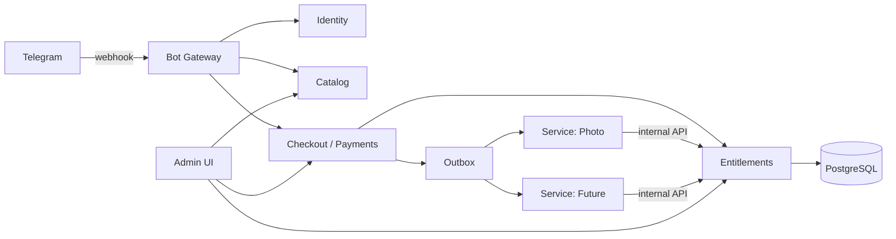
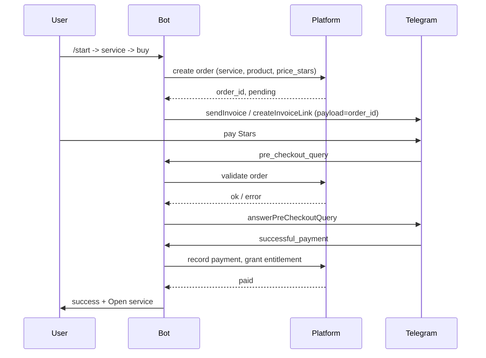
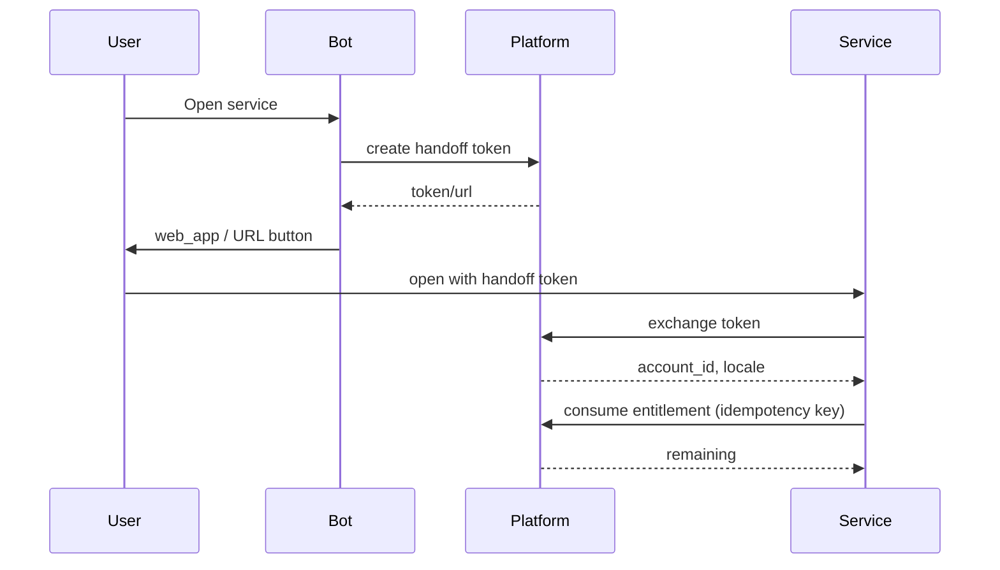
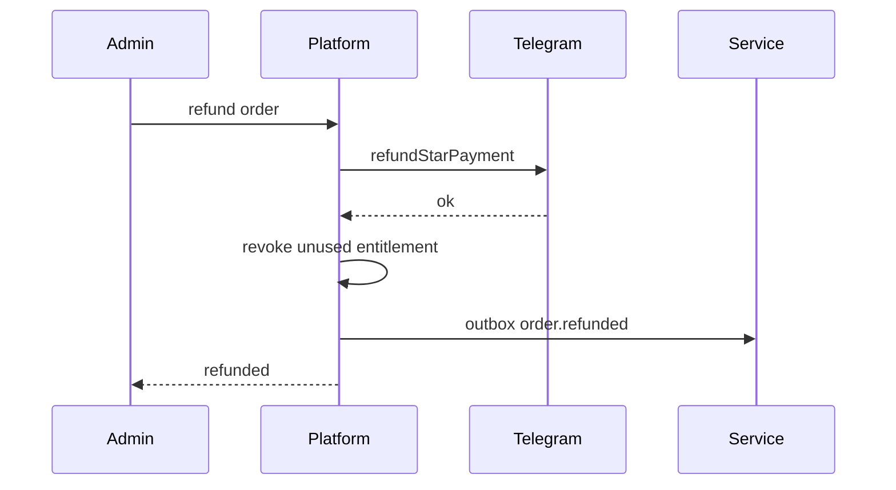

# ТЗ: Telegram-бот-платформа для продажи цифровых услуг

Статус: черновик v0.1  
Дата: 2026-11-07  
Репозиторий: `photo`  
Связанные файлы: `webapp/stars.py`, `webapp/main.py`, `webapp/models.py`, `webapp/billing.py`, `tests/test_telegram.py`

## 1. Контекст

Сейчас Telegram Stars уже реализованы, но жёстко привязаны к DVPhotoChecker:

- `webapp/stars.py` формирует название и описание счёта как «DVPhotoChecker … проверок фото».
- `webapp/main.py` в `_bot_reply` отвечает текстами только про DVPhotoChecker.
- `webapp/billing.py` начисляет `product.photos` в общий баланс проверок.
- `webapp/models.py` хранит в `Product` поле `photos`, а в `Order` — только `product_id`, без `service_id`.
- Вебхук `POST /api/webhooks/telegram` уже реализован: секрет, `pre_checkout_query`, `successful_payment`, идемпотентность по `telegram_payment_charge_id`, возвраты, команды `/start`, `/terms`, `/paysupport`, `/balance`.
- Автоматической регистрации вебхука нет: `setWebhook` вызывается вручную.

Цель — превратить бота в **платформу**, к которой можно подключать новые цифровые сервисы без изменения кода бота и без дублирования платежей, авторизации и выдачи доступов.

## 2. Область работ

### 2.1. Входит в scope

- Единый бот-каталог нескольких сервисов.
- Продажа цифровых товаров и услуг за Telegram Stars.
- Учёт заказов, платежей, возвратов и начислений.
- Выдача и списание доступов (entitlements) по каждому сервису отдельно.
- Переход пользователя из бота в веб-сервис или Mini App с безопасной авторизацией.
- Админка для подключения новых сервисов, товаров и цен.
- Поддержка, возвраты, уведомления, аудит.
- Мультиязычность.
- Наблюдаемость, идемпотентность, безопасность.
- Миграция текущего фото-сервиса на новую модель.
- Подключение второго тестового сервиса для проверки расширяемости.

### 2.2. Не входит в scope

- Фиатный эквайринг, карты, SEPA, KYB/KYC мерчанта.
- Криптоплатежи, кроме Telegram Stars.
- Физические товары и доставка.
- Налоговая и юридическая консультация.
- Собственный кошелёк для хранения Stars.
- Автоматический вывод Stars в TON/фиат (выполняется через Fragment/внешние сервисы).
- Подписки и рекуррентные платежи (можно заложить в модель, но не реализовывать в первой версии).

## 3. Ключевые архитектурные решения

1. **Один бот — много сервисов.** Все сущности, цены, доступы и события namespace-ятся по `service_code`.
2. **Telegram Stars — единственный способ оплаты цифровых товаров внутри Telegram.** Для digital goods `provider_token` пустой, валюта `XTR`. Это требование Apple/Google и Telegram.
3. **Модульный монолит на старте.** Бот, платежи и entitlements живут в одном FastAPI-приложении и одной PostgreSQL. Выделение отдельного сервиса — только когда появится вторая независимая команда/деплой.
4. **Явная цена в Stars.** У товара есть фиксированное `price_stars`. Не пересчитываем цену в момент оплаты; `stars_amount` фиксируется при создании заказа.
5. **Раздельные доступы по сервисам.** Не один общий баланс «проверок», а entitlements с `service_id`, `kind`, `remaining`. Сервис не видит доступы другого сервиса.
6. **Идемпотентность на всех уровнях.** `update_id`, `telegram_payment_charge_id`, `idempotency_key` для внутренних API.
7. **Outbox для интеграций.** После оплаты/возврата платформа пишет событие в outbox, воркер доставляет его сервисам с ретраями.
8. **Бот stateless.** Вебхук можно масштабировать горизонтально; состояние — в БД.
9. **`payload` счёта = ID заказа.** Не JSON, не список товаров. Telegram ограничивает payload 128 байтами; UUID (36 символов) проходит.
10. **Никаких секретов в логах.** Токен бота, `initData`, платёжные идентификаторы и персональные данные не логируются.

## 4. Роли

| Роль | Права |
|---|---|
| Пользователь Telegram | Каталог, покупка, баланс, заказы, поддержка |
| Сервис | Проверка handoff-токена, списание entitlements, чтение статуса заказа по своему сервису |
| Администратор платформы | Сервисы, товары, цены, заказы, возвраты, роли, аудит |
| Администратор сервиса | Только свой сервис: товары, цены, заказы, возвраты |
| Поддержка | Поиск пользователя/заказа, возвраты по регламенту, ответы |
| Финансы | Отчёты, сверка Stars, revenue share, выплаты партнёрам |

## 5. Пользовательские сценарии

1. Пользователь открывает бота `/start` и видит список активных сервисов.
2. Выбирает сервис, видит описание, товары и цену в Stars.
3. Нажимает «Купить», получает счёт Telegram, оплачивает Stars.
4. Бот подтверждает оплату, начисляет доступ и предлагает открыть сервис.
5. Пользователь открывает веб-сервис или Mini App, авторизуется через handoff-токен/`initData`.
6. Сервис списывает одну единицу доступа при выполнении платной операции.
7. При ошибке или запросе поддержки пользователь может запросить возврат; администратор делает возврат Stars, неиспользованный доступ отзывается.
8. Новый сервис подключается через админку: создаются сервис, товары, цены, ссылки, API-токен; после тестовой покупки сервис активируется.

## 6. Архитектура

### 6.1. Компоненты

- **Bot Gateway** — приём вебхука, маршрутизация updates, команды, callback-кнопки, отправка сообщений.
- **Identity** — связь Telegram-пользователя с аккаунтом платформы, язык, профиль.
- **Catalog** — сервисы, товары, цены, доступность.
- **Checkout/Payments** — создание заказа, счёт Stars, `pre_checkout_query`, `successful_payment`, возвраты.
- **Entitlements** — выдача, списание, отзыв, срок действия.
- **Service Integration API** — внутренний API для сервисов: handoff, consume, balance.
- **Outbox Worker** — доставка событий сервисам.
- **Admin API/UI** — управление платформой.
- **Notification Worker** — уведомления пользователям.
- **Observability** — логи, метрики, алерты, health.

### 6.2. Схема



### 6.3. Границы доменов

- Платформа владеет: аккаунтами, сервисами, товарами, заказами, платежами, entitlements, возвратами, аудитом.
- Сервис владеет: своей бизнес-логикой, результатом услуги, своими пользовательскими данными.
- Сервис не пишет напрямую в таблицы платформы. Только через internal API или outbox.
- Платформа не знает, как сервис выполняет услугу; она знает только `service_code`, `kind`, `quantity`.

## 7. Функциональные требования

### 7.1. Онбординг и меню бота

- `/start` без payload:
  - приветствие;
  - список активных сервисов;
  - краткий баланс по сервисам;
  - кнопки «Мои заказы», «Поддержка», «Язык».
- `/start svc_<service_code>` — карточка конкретного сервиса.
- `/start buy_<product_id>` — сразу checkout, если товар активен.
- `/services` — список сервисов.
- `/balance` — баланс по каждому сервису.
- `/orders` — последние 10 заказов со статусами.
- `/terms`, `/privacy` — ссылки на юридические страницы (платформа и/или сервис).
- `/paysupport` — обязательная команда по правилам Telegram: контакт поддержки и инструкция.
- `/support` — контакт поддержки.
- `/language` — выбор языка: ru/en/es/fa/uz/sah; по умолчанию `language_code` из Telegram, fallback `en`.
- Меню-кнопка бота: «Сервисы» или «Каталог».
- Команды регистрируются через `setMyCommands`.
- Неизвестная команда — короткая подсказка, без падения.
- Все тексты — из i18n, без хардкода названий сервисов.

### 7.2. Каталог сервисов

- Сервис имеет: `code`, название, описание, иконку/эмодзи, статус, ссылки terms/privacy/support, `webapp_url`/`handoff_url`, сортировку.
- Товар имеет: `code`, название, описание, `price_stars`, `entitlement_kind`, `quantity`, срок действия, активность.
- Карточка сервиса:
  - название и описание;
  - список товаров с ценой в Stars;
  - кнопки «Купить»;
  - кнопка «Открыть сервис» (если уже есть доступ);
  - ссылки на условия/поддержку.
- Callback data — короткие имена с ID, не длинные JSON: `svc:<id>`, `buy:<product_id>`, `open:<service_id>`.
- Неактивный сервис/товар не показывается в каталоге; прямой deep link возвращает понятное сообщение.
- Kill switch на сервис и на товар.

### 7.3. Создание заказа

- Заказ создаётся только для активного сервиса и активного товара.
- Поля заказа: `id`, `account_id`, `service_id`, `product_id`, `price_stars`, `status=pending`, `provider=telegram_stars`, `telegram_user_id`, `created_at`, `expires_at`, `invoice_url`/`invoice_payload`.
- `price_stars` берётся из товара и фиксируется; при изменении цены старые заказы не пересчитываются.
- Защита от двойного клика: не более одного pending-заказа на `account_id + product_id` в течение 30 секунд; повторный клик возвращает существующий счёт.
- Заказ истекает через 30 минут; фоновый job переводит `pending` → `expired`, если оплаты не было.
- `payload` счёта — `order.id`.

### 7.4. Счёт Telegram

- Для чата бота использовать `sendInvoice`; для сайта/Mini App — `createInvoiceLink`.
- Параметры:
  - `provider_token=""`;
  - `currency="XTR"`;
  - `title` 1–32 символа;
  - `description` 1–255 символов;
  - `prices=[{label, amount}]`;
  - `payload=order.id`.
- Название и описание счёта формируются из сервиса/товара, а не из хардкода.
- После отправки счёта пользователь может оплатить, отменить или закрыть чат.
- Если пользователь заблокировал бота, заказ всё равно может быть оплачен по ранее выданной ссылке; зачисление выполняет вебхук, уведомление может не дойти.

### 7.5. `pre_checkout_query`

- Обработать за ≤10 секунд.
- Проверить:
  - заказ существует;
  - `provider=telegram_stars`;
  - статус `pending` (или допустимый `expired` по политике поздней оплаты);
  - сервис и товар активны;
  - `currency=XTR`;
  - `total_amount == order.price_stars`;
  - пользователь не заблокирован платформой.
- При ошибке: `ok=false` и понятная причина на языке пользователя.
- Все проверки — только БД, без внешних HTTP-вызовов.
- Ответ отправлять из threadpool, не блокируя event loop.
- Если ответ не успел — Telegram отменит платёж; это допустимо, но нужно логировать и алертить.

### 7.6. `successful_payment`

- Считать единственным доказательством оплаты.
- Идемпотентность:
  - уникальный ключ `tg:<telegram_payment_charge_id>`;
  - дополнительно хранить `update_id`;
  - повторный update не начисляет доступ повторно.
- Проверить:
  - заказ существует;
  - `currency=XTR`;
  - `total_amount == order.price_stars`;
  - заказ ещё не `paid`/`refunded`;
  - сервис/товар активны (если выключены — зачислить и пометить `review`/уведомить админа).
- Транзакционно:
  - `order.status=paid`, `paid_at`, `payment_id=charge_id`;
  - запись в `payment_events`;
  - создание entitlement;
  - запись в `entitlement_ledger`;
  - outbox-событие `order.paid`.
- При несовпадении суммы/валюты/заказа:
  - не начислять;
  - `order.status=review`;
  - событие `payment.review`;
  - алерт администратору.
- Отправить пользователю подтверждение и кнопку «Открыть сервис».
- Вернуть Telegram `200 OK` после успешной обработки; при временной ошибке БД — `5xx`, чтобы Telegram повторил update.

### 7.7. Entitlements

- Продукт задаёт:
  - `kind` — тип доступа (`photo_check`, `export`, `analysis`, …);
  - `quantity` — сколько единиц;
  - `expires_in_days` — опционально.
- При оплате создаётся entitlement:
  - `account_id`, `service_id`, `kind`, `quantity`, `remaining=quantity`, `source_order_id`, `expires_at`, `status=active`.
- Уникальность: один entitlement на `source_order_id + kind`.
- Списание:
  - `POST /internal/v1/entitlements/consume`;
  - проверка `service_code` из токена сервиса;
  - транзакция с блокировкой строки;
  - если `remaining <= 0` — `409`/`402` с кодом `insufficient_entitlement`;
  - если истёк — `409` с кодом `expired`;
  - идемпотентность по `Idempotency-Key`: повторный запрос возвращает тот же результат, не списывая второй раз.
- Возврат:
  - отзывать только неиспользованный остаток;
  - если доступ уже использован — ручное решение администратора;
  - при отзыве писать ledger `-remaining`, `status=revoked`.
- Срок действия: ежедневный job помечает истёкшие; списание истёкших запрещено.
- Сервис не может списать entitlement другого сервиса.

### 7.8. Переход в сервис и авторизация

Поддерживаются два варианта.

**A. Telegram Mini App**

- Кнопка `web_app` с URL сервиса.
- Сервис проверяет `Telegram.WebApp.initData`:
  - HMAC-SHA256 по `bot_token`;
  - срок жизни `auth_date` (например, ≤5 минут);
  - `user.id` совпадает с аккаунтом;
  - защита от повторного использования.
- Платформа может выдавать `initData`-совместимый токен, если сервис не хочет знать токен бота.

**B. Внешний веб-сервис**

- Платформа выдаёт одноразовый handoff-токен:
  - `POST /internal/v1/handoff`;
  - TTL 60 секунд;
  - одноразовый;
  - HMAC/подпись;
  - содержит `account_id`, `service_code`, `exp`;
  - передаётся в URL `?handoff=...` или в заголовке.
- Сервис обменивает токен на свою сессию через `POST /internal/v1/handoff/exchange`.
- Токен нельзя использовать повторно; при повторном использовании — `401` и лог.
- Для веб-аккаунтов с email/Google: связать Telegram-идентичность с существующим `account_id`; не создавать дубликаты.
- Для bot-first пользователей: аккаунт создаётся без email; email запрашивается только когда он реально нужен сервису.

### 7.9. Возвраты

- Возврат инициирует администратор/поддержка.
- Только для `paid` заказов с `provider=telegram_stars` и `payment_id`.
- Вызов `refundStarPayment(user_id, telegram_payment_charge_id)`.
- При успехе:
  - `order.status=refunded`;
  - отзыв неиспользованного entitlement;
  - outbox `order.refunded`;
  - уведомление пользователю.
- При ошибке Telegram:
  - заказ остаётся `paid`;
  - доступ не отзывается;
  - администратор видит ошибку и может повторить.
- Частичный возврат Stars не поддерживается API; при необходимости — ручное начисление/списание.
- Политика возврата должна быть опубликована и привязана к сервису.

### 7.10. Поддержка

- `/paysupport` обязателен.
- Пользователь может отправить `/paysupport <order_id>` и получить статус заказа.
- Админ-поиск по `telegram_user_id`, `order_id`, `charge_id`, email.
- Шаблоны ответов: оплата не пришла, оплата прошла, возврат, доступ не начислился.
- Эскалация администратору при `review`/`amount mismatch`.
- SLA и каналы — по регламенту платформы.

### 7.11. Админка

- Веб-админка (расширение текущей `/admin`).
- Разделы:
  - сервисы;
  - товары и цены;
  - заказы;
  - платежи/события;
  - entitlements;
  - возвраты;
  - пользователи;
  - аудит;
  - отчёты.
- Онбординг сервиса:
  - код, название, описание, иконка;
  - `webapp_url`/`handoff_url`;
  - terms/privacy/support;
  - API-токен сервиса;
  - товары, цены, entitlement kind/quantity;
  - комиссия платформы;
  - статус `draft/active/disabled`.
- Валидация:
  - уникальный `service_code`;
  - уникальный `product_code` внутри сервиса;
  - `price_stars >= 1`;
  - URL только `https`;
  - обязательные legal/support ссылки для active.
- Kill switch: отключение сервиса/товара без удаления данных.
- RBAC: платформенный админ, админ сервиса, поддержка, финансы.
- Аудит: кто, что, когда изменил; before/after.

### 7.12. Подключение нового сервиса

Новый сервис подключается без изменения кода бота:

1. Создать сервис в админке.
2. Создать товары и цены в Stars.
3. Указать handoff/webapp URL, terms/privacy/support.
4. Выдать сервису API-токен.
5. Сервис реализует:
   - приём handoff-токена и обмен на сессию;
   - `POST /internal/v1/entitlements/consume`;
   - `GET /internal/v1/entitlements`;
   - health-check.
6. Провести тестовую покупку в тестовом боте/среде.
7. Проверить возврат и отзыв доступа.
8. Активировать сервис.

Пример манифеста:

```yaml
code: photo
name: DVPhotoChecker
status: draft
webapp_url: https://example.com/app
terms_url: https://example.com/legal/terms
privacy_url: https://example.com/legal/privacy
support_email: support@example.com
platform_fee_bps: 1000
products:
  - code: solo
    name: 1 проверка
    price_stars: 231
    entitlement_kind: photo_check
    entitlement_quantity: 1
  - code: pack5
    name: 5 проверок
    price_stars: 615
    entitlement_kind: photo_check
    entitlement_quantity: 5
```

### 7.13. Уведомления

- Пользователю:
  - оплата успешна;
  - доступ начислен;
  - возврат выполнен;
  - доступ истекает;
  - ошибка платежа (review).
- Админу:
  - `amount mismatch`;
  - `unknown order`;
  - повторные ошибки вебхука;
  - сервис недоступен;
  - очередь outbox растёт.
- Уведомления отправлять через worker с retry/backoff, не блокируя вебхук.
- Не спамить; учитывать блокировку бота.

### 7.14. Отчёты и финансы

- Заказы по сервисам, периодам, статусам.
- Выручка в Stars, возвраты, средний чек, конверсия.
- Комиссия платформы и доля сервиса:
  - `gross_stars`, `platform_fee_stars`, `service_share_stars`;
  - хранить на заказе или в ledger.
- Сверка с балансом Stars в Telegram.
- Экспорт CSV/JSON.
- Если сервисы партнёрские — реестр выплат и статусы.

## 8. Нефункциональные требования

### 8.1. Безопасность

- HTTPS обязателен; вебхук только по HTTPS.
- `X-Telegram-Bot-Api-Secret-Token` обязателен; сравнение constant-time.
- В production приложение не стартует, если токен задан, а webhook secret пуст.
- `initData` проверять по HMAC; проверять `auth_date`; защита от replay.
- Внутренние API — Bearer-токены, хранить только хеш; scope по сервису; ротация.
- Не логировать токен бота, `initData`, charge_id в открытом виде (charge_id можно в masked виде).
- Ограничение размера тела вебхука; JSON-схема; rate limit.
- RBAC и аудит.
- Секреты — через env/secret manager, не в git.
- Учесть санкционные и региональные ограничения Telegram/Apple/Google.

### 8.2. Надёжность

- Идемпотентность: `update_id`, `telegram_payment_charge_id`, `Idempotency-Key`.
- Outbox + retry + dead-letter.
- Уникальные ограничения в БД для платежей и entitlements.
- Транзакции на оплату/списание/возврат.
- Graceful shutdown.
- При недоступности сервиса платёж всё равно зачисляется; доступ ждёт в платформе.
- При недоступности Telegram API — retry, но не терять заказ.

### 8.3. Производительность

- p95 обработки вебхука без Bot API — ≤300 мс.
- `pre_checkout_query` — ответ ≤10 с (цель ≤1 с).
- Горизонтальное масштабирование stateless-вебхука.
- Индексы по `orders.status`, `orders.telegram_user_id`, `payment_events.event_key`, `entitlements.account_id+service_id`.
- Очереди не должны блокировать event loop.

### 8.4. Локализация

- Языки: ru, en, es, fa, uz, sah.
- Fallback — en.
- Язык сохраняется за аккаунтом; можно менять `/language`.
- Названия сервисов/товаров локализуются; если перевода нет — fallback.
- Ошибки пользователю — на его языке.

### 8.5. Наблюдаемость

- Структурные логи: `update_id`, `account_id`, `order_id`, `service_code`, `charge_id` (masked), `status`.
- Метрики:
  - updates received/processed/failed;
  - payments succeeded/failed/review;
  - webhook latency;
  - outbox lag;
  - pending updates в Telegram;
  - entitlement consume errors.
- Алерты:
  - `getWebhookInfo.last_error_message` не пуст;
  - `pending_update_count` растёт;
  - amount mismatch;
  - outbox dead-letter;
  - рост 5xx.
- Health endpoints: `/healthz`, `/readyz`.
- Периодическая проверка `getWebhookInfo`.

### 8.6. Данные и приватность

- Минимизация PII.
- Хранить: Telegram ID, username (опционально), язык, заказы, платежи, entitlements.
- Не хранить лишние данные платёжных карт (их и нет).
- Срок хранения заказов/платежей — по налоговым требованиям.
- Удаление аккаунта: анонимизировать PII, сохранить финансовые записи в требуемом объёме.
- Политика конфиденциальности платформы и сервисов.

## 9. Модель данных

### 9.1. Accounts / Identity

```text
accounts
  id uuid pk
  email varchar(255) null unique
  name varchar(255) null
  locale varchar(8) not null default 'en'
  created_at timestamptz
  deleted_at timestamptz null

account_identities
  id uuid pk
  account_id uuid fk accounts
  provider varchar(32)       -- telegram | google | email
  subject varchar(255)       -- telegram_user_id / google_sub / email
  unique(provider, subject)
  created_at timestamptz

telegram_profiles
  account_id uuid pk fk accounts
  telegram_user_id bigint unique
  username varchar(64) null
  language_code varchar(8) null
  last_seen_at timestamptz
```

Примечание: текущий `users.email` обязателен. Для bot-first пользователей либо сделать email nullable, либо использовать отдельный `accounts` и связать с `users`. Рекомендуется перейти на `accounts` + `account_identities`; это упростит Google/email/Telegram.

### 9.2. Services / Products

```text
services
  id uuid pk
  code varchar(32) unique
  name varchar(128)
  description text
  status varchar(16)          -- draft | active | disabled
  webapp_url varchar(1024) null
  handoff_url varchar(1024) null
  terms_url varchar(1024)
  privacy_url varchar(1024)
  support_email varchar(255)
  platform_fee_bps int not null default 0
  sort_order int not null default 0
  created_at timestamptz

service_products
  id uuid pk
  service_id uuid fk services
  code varchar(32)
  name varchar(128)
  description text
  price_stars int not null check (price_stars >= 1)
  entitlement_kind varchar(32)
  entitlement_quantity int not null check (entitlement_quantity > 0)
  entitlement_ttl_days int null
  active boolean not null default true
  sort_order int not null default 0
  unique(service_id, code)
```

### 9.3. Orders / Payments

```text
orders
  id uuid pk
  account_id uuid fk accounts
  service_id uuid fk services
  product_id uuid fk service_products
  provider varchar(32)        -- telegram_stars
  status varchar(32)          -- pending | paid | review | refunded | expired | failed
  price_stars int
  telegram_user_id bigint null
  payment_id varchar(255) null -- telegram_payment_charge_id
  invoice_url varchar(2048) null
  created_at timestamptz
  expires_at timestamptz
  paid_at timestamptz null
  refunded_at timestamptz null
  unique(provider, payment_id) where payment_id is not null

payment_events
  id uuid pk
  order_id uuid null fk orders
  service_id uuid null fk services
  event_key varchar(255) unique   -- tg:<charge_id> | hash
  telegram_update_id bigint null unique
  payment_id varchar(255) null
  status varchar(64) null
  payload jsonb
  created_at timestamptz
```

### 9.4. Entitlements

```text
entitlements
  id uuid pk
  account_id uuid fk accounts
  service_id uuid fk services
  kind varchar(32)
  quantity int
  remaining int
  status varchar(16)          -- active | exhausted | expired | revoked
  source_order_id uuid fk orders
  expires_at timestamptz null
  created_at timestamptz
  unique(source_order_id, kind)

entitlement_ledger
  id uuid pk
  entitlement_id uuid fk entitlements
  account_id uuid fk accounts
  service_id uuid fk services
  delta int
  reason varchar(64)          -- purchase | consume | refund | expiry | adjust
  idempotency_key varchar(128) null
  metadata jsonb
  created_at timestamptz
  unique(service_id, idempotency_key) where idempotency_key is not null
```

### 9.5. Integration / Ops

```text
service_api_tokens
  id uuid pk
  service_id uuid fk services
  token_hash varchar(64) unique
  scopes text[]
  created_at timestamptz
  revoked_at timestamptz null

outbox_events
  id uuid pk
  event_type varchar(64)
  aggregate_id uuid
  service_id uuid null
  payload jsonb
  status varchar(16)          -- pending | sent | failed | dead
  attempts int default 0
  next_attempt_at timestamptz
  created_at timestamptz

bot_updates
  update_id bigint pk
  processed_at timestamptz
  result varchar(16)

audit_log
  id uuid pk
  actor_account_id uuid null
  action varchar(64)
  entity_type varchar(32)
  entity_id varchar(64)
  before jsonb null
  after jsonb null
  created_at timestamptz
```

## 10. API

### 10.1. Telegram webhook

`POST /api/webhooks/telegram`

- Заголовок `X-Telegram-Bot-Api-Secret-Token`.
- Принимает `pre_checkout_query`, `message.successful_payment`, команды.
- Возвращает `200` для обработанных/дубликатов, `401` при неверном секрете, `5xx` только для retryable ошибок.
- Не выполняет тяжёлую работу в request path.

### 10.2. Internal API для сервисов

Авторизация: `Authorization: Bearer <service_token>`, токен привязан к `service_id`.

**Handoff**

```http
POST /internal/v1/handoff
Content-Type: application/json

{
  "account_id": "uuid",
  "service_code": "photo"
}
```

```json
{
  "token": "one-time-token",
  "url": "https://service.example/app?handoff=one-time-token",
  "expires_in": 60
}
```

**Exchange**

```http
POST /internal/v1/handoff/exchange
Content-Type: application/json

{"token": "one-time-token"}
```

```json
{
  "account_id": "uuid",
  "service_code": "photo",
  "locale": "ru"
}
```

**Consume**

```http
POST /internal/v1/entitlements/consume
Authorization: Bearer <service_token>
Idempotency-Key: <uuid>
Content-Type: application/json

{
  "account_id": "uuid",
  "kind": "photo_check",
  "quantity": 1,
  "metadata": {"job_id": "..."}
}
```

```json
{
  "ok": true,
  "entitlement_id": "uuid",
  "remaining": 0,
  "balance": 0
}
```

Ошибки:

- `402 insufficient_entitlement`
- `409 expired`
- `409 service_mismatch`
- `422 validation_error`

**Balance**

```http
GET /internal/v1/entitlements?account_id=uuid&kind=photo_check
Authorization: Bearer <service_token>
```

```json
{
  "balance": 2,
  "items": [
    {
      "entitlement_id": "uuid",
      "kind": "photo_check",
      "remaining": 2,
      "expires_at": null,
      "status": "active"
    }
  ]
}
```

### 10.3. Admin API

- `GET/POST/PATCH /api/admin/services`
- `GET/POST/PATCH /api/admin/services/{id}/products`
- `GET /api/admin/orders`
- `POST /api/admin/orders/{id}/refund`
- `GET /api/admin/entitlements`
- `POST /api/admin/entitlements/{id}/adjust`
- `GET /api/admin/audit`
- `GET /api/admin/reports/revenue`

Все изменяющие запросы — с CSRF/авторизацией и записью в `audit_log`.

## 11. Последовательности

### 11.1. Покупка



### 11.2. Переход в сервис



### 11.3. Возврат



## 12. Конфигурация и деплой

### 12.1. Переменные окружения

```text
PUBLIC_BASE_URL=https://example.com
TELEGRAM_BOT_TOKEN=...
TELEGRAM_WEBHOOK_SECRET=...
TELEGRAM_BOT_USERNAME=...
DATABASE_URL=postgresql://...
SECRET_KEY=...
```

Для каждого сервиса — не env, а запись в БД и токен через админку/секрет-менеджер.

### 12.2. Регистрация вебхука

Первичная установка:

```bash
curl -sS "https://api.telegram.org/bot$TELEGRAM_BOT_TOKEN/setWebhook" \
  -d "url=$PUBLIC_BASE_URL/api/webhooks/telegram" \
  -d "secret_token=$TELEGRAM_WEBHOOK_SECRET" \
  -d "drop_pending_updates=true"
```

Проверка:

```bash
curl -sS "https://api.telegram.org/bot$TELEGRAM_BOT_TOKEN/getWebhookInfo"
```

Требования:

- HTTPS с валидным сертификатом.
- Не указывать `allowed_updates` без `pre_checkout_query` и `message`; лучше не указывать вовсе.
- При смене домена/секрета — повторный `setWebhook`.
- Для локальной разработки — отдельный тестовый бот + ngrok/cloudflared либо long polling (если добавим).
- `drop_pending_updates=true` только при первом подключении; при обычном деплое не сбрасывать очередь.

### 12.3. Деплой

1. Применить миграции Alembic.
2. Задеплоить приложение.
3. Проверить `/healthz`, `/readyz`.
4. Проверить `getWebhookInfo`.
5. Прогнать smoke-тест: каталог → тестовая покупка → доступ → возврат.
6. Включить сервис/товар.

## 13. Тестирование и приёмка

### 13.1. Тесты

- Unit:
  - парсинг update;
  - проверка секрета;
  - расчет Stars/цена;
  - валидация pre-checkout;
  - идемпотентность;
  - выдача/списание/возврат;
  - i18n fallback.
- Integration:
  - вебхук с фейковым Bot API;
  - duplicate `successful_payment`;
  - amount mismatch;
  - unknown order;
  - refund success/fail;
  - handoff token replay;
  - service token isolation.
- E2E:
  - тестовый бот + тестовая среда Stars;
  - реальная покупка;
  - открытие сервиса;
  - списание;
  - возврат.
- Load:
  - 20–50 rps вебхука;
  - p95;
  - отсутствие блокировки event loop.
- Security:
  - неверный секрет;
  - повтор initData;
  - чужой service token;
  - SQL-инъекции/валидация.

### 13.2. Acceptance criteria

- [ ] Новый сервис добавляется через админку без деплоя и изменения кода.
- [ ] Пользователь видит сервисы, товары и цены в Stars.
- [ ] Оплата Stars начисляет entitlement ровно один раз.
- [ ] Повторный `successful_payment` не удваивает доступ.
- [ ] `pre_checkout_query` отвечает менее чем за 10 секунд.
- [ ] Неверная сумма/валюта не начисляет доступ и уходит в `review`.
- [ ] Возврат Stars отзывает неиспользованный доступ.
- [ ] Использованный доступ не отзывается автоматически без решения админа.
- [ ] Сервис не может списать доступ другого сервиса.
- [ ] Handoff-токен одноразовый и истекает.
- [ ] Все пользовательские тексты локализованы.
- [ ] В production без `TELEGRAM_WEBHOOK_SECRET` приложение не стартует.
- [ ] `getWebhookInfo` без ошибок и застоя.
- [ ] Логи не содержат токен/секреты.
- [ ] Есть runbook на инциденты: вебхук, оплата, возврат, недоступность сервиса.

## 14. Этапы

### Этап 0. Стабилизация текущего бота

- Вынести тексты и названия сервиса из хардкода.
- Добавить `sendInvoice` для чата.
- Настроить `setWebhook`/`getWebhookInfo`.
- Добавить health-check вебхука.
- Документировать запуск.

### Этап 1. Платформенная модель

- `accounts`/`account_identities`.
- `services`, `service_products`.
- `service_id` в заказах и payment events.
- Entitlements и ledger.
- Миграция фото-сервиса.
- Тесты.

### Этап 2. Интеграции и админка

- Internal API: handoff, consume, balance.
- Outbox worker.
- Админка сервисов/товаров.
- Второй тестовый сервис.
- Возвраты и аудит.

### Этап 3. Эксплуатация

- Метрики, алерты, дашборд.
- Нагрузочные тесты.
- Runbook.
- Пилот с реальными пользователями.

## 15. Риски и открытые вопросы

1. **Модель аккаунтов.** Сейчас `users.email` обязателен. Нужно решить: делать email nullable или вводить отдельный `accounts`/`account_identities`. Рекомендуется второй вариант.
2. **Тип сервисов.** Web app, Mini App или собственный бот? От этого зависит handoff/`initData`.
3. **Revenue share.** Если сервисы партнёрские, нужна модель комиссии и выплат. Если все сервисы ваши — можно отложить.
4. **Возвраты после использования.** Нужна политика: возвращать только неиспользованный доступ или рассматривать вручную.
5. **Срок жизни Stars.** Уточнить у Telegram актуальные правила вывода и удержаний; заложить сверку.
6. **Регионы.** Telegram/Apple/Google могут ограничивать покупки Stars в отдельных странах.
7. **Налоги.** Stars — не фиат; налоговая обязанность и учёт — на операторе платформы.
8. **Один бот vs бот на сервис.** На старте — один бот. Если сервисов станет много и появятся партнёры, можно добавить отдельные боты с общим platform API.
9. **Подписки.** Если понадобятся, проверить поддержку рекуррентных платежей в Stars и Apple/Google.
10. **Лимиты Telegram.** Учесть rate limits Bot API, размеры сообщений, callback data, payload.

## 16. Definition of Done

ТЗ считается реализованным, когда:

- платформа поддерживает минимум два сервиса;
- новый сервис подключается через админку без деплоя;
- оплата, выдача, списание и возврат работают идемпотентно;
- есть админка, аудит, отчёты;
- есть тесты, метрики, алерты и runbook;
- текущий фото-сервис работает через новую модель без регрессий;
- документация по запуску и подключению сервиса опубликована.
